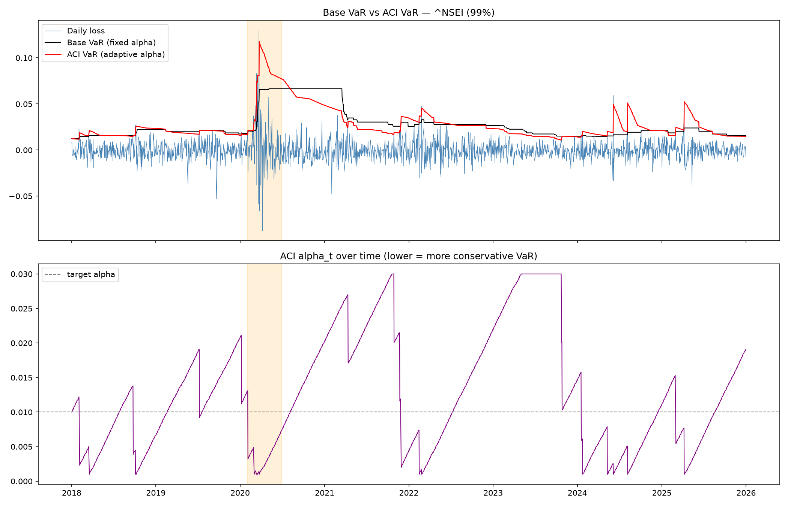

# ACI VaR Research

Backtesting 1-day Value at Risk on the Nifty 50 (`^NSEI`) and S&P 500 (`^GSPC`), from plain rolling historical VaR to **Adaptive Conformal Inference (ACI)** (Gibbs & Candès, 2021). This is the research behind the `var` command in [AI Research Terminal](https://github.com/adyantsinghcodes-sys/ai-research-terminal).

## The question

Rolling historical VaR is easy to compute but reacts slowly: after a regime change it keeps using a year of calm data, so breaches cluster in crises. Can conformal calibration fix the breach rate without making VaR uniformly wider?

## Pipeline

| Step | Script | What it does |
|---|---|---|
| 1 | `01_explore.py` | Full-sample VaR/CVaR; rolling 95% and 99% VaR with breaches |
| 2 | `02_garch.py` | ADF test, ACF of raw vs squared returns, GARCH(1,1) conditional volatility vs breaches |
| 3 | `03_backtest.py` | Kupiec (breach rate) and Christoffersen (breach clustering) tests: full sample, crisis windows, calm periods |
| 4 | `04_conformal_toy.py` | Split conformal on synthetic heteroskedastic data, to check the coverage guarantee |
| 5 | `05_conformal_var.py` | Static conformal VaR: one shift learned on 2005–2017, tested on 2018–2025 |
| 6 | `06_aci_var.py` | ACI VaR: the quantile level adapts daily after each breach / non-breach |
| 7 | `07_conformal_cvar.py` | Conformalized CVaR, evaluated by the exceedance ratio on breach days |

Shared data loading, VaR and test code lives in `common.py`.

**VaR definition.** VaR for day *t* is the empirical quantile of the previous 252 daily losses (day *t* excluded). **ACI update:** `alpha_{t+1} = clip(alpha_t + gamma * (alpha - err_t), bounds)`, with target `alpha = 0.01`, `gamma = 0.01`, `bounds = (0.001, 0.03)`. Calibration period: 2005–2017. Test period: 2018–2025, which includes the 2020 COVID crash out of sample.

## Run

```bash
pip install -r requirements.txt
python 06_aci_var.py --ticker ^NSEI
python 06_aci_var.py --ticker ^GSPC --gamma 0.01 --bounds 0.001 0.03
```

Every script takes `--ticker`, `--start` and `--end`. Plots are written to `plots/`.

## Results (99% VaR, test period 2018–2025)

| | ^NSEI breach rate | Kupiec p | Christoffersen p | ^GSPC breach rate | Kupiec p | Christoffersen p |
|---|---|---|---|---|---|---|
| Rolling historical VaR | 1.62% | **0.011** | 0.109 | 1.84% | **0.001** | **0.000** |
| Static conformal VaR | 1.06% | 0.774 | **0.019** | 1.39% | 0.095 | **0.006** |
| ACI VaR | 1.42% | 0.078 | 0.415 | 1.64% | **0.008** | 0.118 |

Target breach rate 1.00%. **Bold** = rejected at 5%.

**Findings**

- **Static conformal fixes the rate, not the clustering.** One shift learned on 2005–2017 brings the breach rate close to target on both indices, but breaches still cluster.
- **ACI reduces clustering, not enough breaches.** No significant clustering on either index, but on the S&P 500 the breach rate is still too high. Neither method passes both tests on the S&P 500.
- **ACI is more efficient, not just wider.** 2020 crisis breach rate: 9.09% → 6.06% (Nifty), 7.69% → 4.81% (S&P), while mean VaR in calm periods is slightly lower than the base model. Crisis breaches remain 5–6× the target.
- **Conformal CVaR** improves the breach-day exceedance ratio (1.154 → 1.074 Nifty, 1.203 → 1.112 S&P) but still underestimates crisis losses (ratio 1.32–1.34).



## Limitations

- **Christoffersen has low power** with ~30 test-period breaches; "fail to reject" means no clustering was detected, not that breaches are independent.
- **Nifty data starts in September 2007**, so its calibration period effectively begins in September 2008 (after the 252-day warm-up).

- **ACI parameters were chosen while looking at test-period results.** `gamma` and `bounds` were picked from a sweep evaluated on 2018–2025, so the ACI results above are partly in-sample. Re-tuning on a pre-2018 validation slice is the next step.
- **GARCH is diagnostic only.** GARCH(1,1) is fitted to show volatility clustering and why rolling VaR lags; no GARCH-based VaR is built here.
- **At the lower bound, ACI VaR is roughly the window maximum.** With 252 observations, the 99.9% quantile sits a quarter of an observation into the tail, so the post-crash spikes in ACI VaR are largely "the worst day of the last year".
- **Two indices only.** Behaviour on individual stocks (fatter tails, earnings jumps) is untested.
- **Crisis-window Christoffersen** joins 2008–09 and 2020 back to back, which adds one artificial transition. The effect is negligible.

## Fixes from earlier versions

Earlier local versions computed rolling VaR with a window that included the day being tested (look-ahead bias), and counted the 252-day warm-up as non-breach days. Both undercounted breaches for the rolling-VaR baseline. All results here use the corrected definition.
